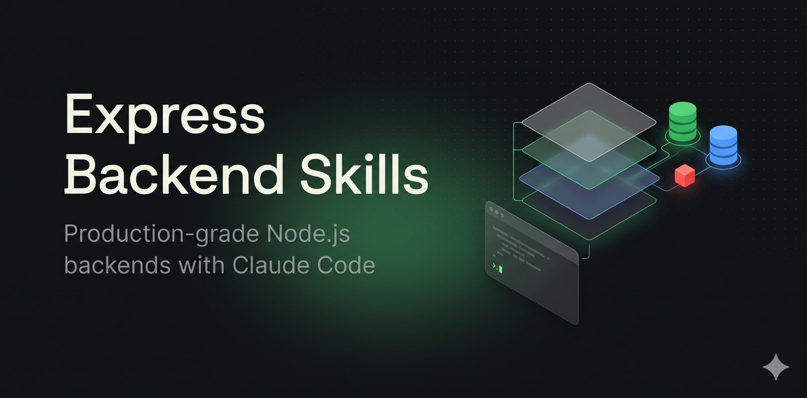

<p align="center">
  
</p>

# Express Backend Skills for Claude Code

Opinionated, production-tested skills that teach Claude Code to build Node.js backends the same way every time: Express 5, ES Modules, MongoDB (Mongoose) or PostgreSQL (Prisma 7), Redis, Zod 4 and winston.

Say **"create a backend for a clinic appointment app using MongoDB"** and Claude plans the entities and API contract, waits for your OK, then generates the whole project — folders, file names, config, database layer, auth with rotating refresh tokens, feature modules, validation, API docs and Docker — all following one consistent architecture.

## Install

```
/plugin marketplace add manishdashsharma/express-backend-skills
/plugin install express-backend@backend-skills
```

Skills trigger automatically from what you ask, or call them directly, for example `/express-backend:create-backend`.

## Skills

| Skill | What it does |
|---|---|
| `create-backend` | Builds a complete backend from a product description: contract → skeleton → data layer → auth → modules → docs → verify. Ships lint-clean templates. |
| `new-module` | Adds one feature module to an existing backend, matching its conventions. |
| `backend-conventions` | The house rules: layout, naming, layer responsibilities, errors, response envelope, pagination, style. |
| `mongoose-mongodb` | Models, indexes, `.select`/`.lean`, pagination, `$in` batching, aggregation, transactions, serverless connections. |
| `prisma-postgres` | Read/write getters, schema rules, `select`, transactions and counters, error codes, migrations, raw SQL. |
| `redis-cache` | Cache-aside, key naming, TTLs, invalidation, non-fatal Redis, SCAN, rate limiting, pub/sub. |
| `auth-sessions` | Access JWT + httpOnly refresh cookie, in-place rotation with reuse detection, Google sign-in, logout everywhere. |
| `ai-integration` | OpenAI-compatible `AIClient`, BYOK with AES-256-GCM, SSRF guard, model fallback, SSE streaming, tool-calling agents with approval, usage logging, evals. |
| `security-hardening` | Tenant isolation, input limits, headers/CORS, secrets, SSRF, sanitization, log hygiene. |
| `scheduled-jobs` | Idempotent, batched cron scripts run by supercronic — no queue library. |
| `api-docs` | `api/<module>.md` per module plus an index, derived from real routes and schemas. |
| `nextjs-api-routes` | The same module discipline inside Next.js `app/api/**/route.js`. |
| `deploy-docker` | Multi-stage Dockerfile, migrations entrypoint, compose for local DBs, health checks, production checklist. |
| `backend-review` | Strict review that fixes every violation and reports what needs a human. |
| `session-log` | Daily `sessions/YYYY-MM-DD.md` handoff notes so work resumes cleanly. |

## The opinions

These skills are deliberately strict. If you disagree with one, put your rule in your project's `CLAUDE.md` — project rules always win.

- Module per feature: `controllers/`, `services/`, `routes/`, `validations/`, `index.js`.
- Routes are `GET` and `POST` only. Update is `POST /:id`, delete is `POST /:id/remove`.
- Soft delete everywhere (`isActive`), every query scoped to a tenant field, another tenant's record is 404.
- Always select fields explicitly, never query in a loop, parallelize independent queries, index every filter.
- Services throw `Error` with `statusCode`; one response envelope; no double-wrapped `data`.
- Redis always has a TTL and is never fatal.
- One config module reads `process.env`. `logger`, never `console.log`.
- No code comments: names carry the meaning.
- No features, libraries or abstractions nobody asked for.

## Layout

```
.claude-plugin/
  plugin.json
  marketplace.json
skills/
  <skill>/SKILL.md
  create-backend/templates/
    common/      app, server, config, shared/, health + auth modules, CLAUDE.md, api/ docs
    mongodb/     Mongoose connection, User/Session models, auth service, Docker
    postgres/    Prisma schema and config, auth service, Docker
    ai/          AIClient, model pool, secret box, SSRF guard, assistant module
    */examples/  a complete reference feature module for each database
```

Every template file is named exactly as it lands in the generated project, and both database variants are tested end to end (auth, refresh rotation and reuse detection, CRUD, tenant isolation, AI streaming with tools).

## Contributing

Issues and pull requests are welcome. Keep templates lint-clean against `skills/create-backend/templates/common/eslint.config.js`, and keep each skill focused on one job.

## Built by

**Manish Dash Sharma**, Senior Software Engineer, GenAI & Full-Stack Developer.

🌐 [manishdashsharma.com](https://www.manishdashsharma.com/) · 🐙 [@manishdashsharma](https://github.com/manishdashsharma)

## License

[MIT](LICENSE) © [Manish Dash Sharma](https://www.manishdashsharma.com/)
